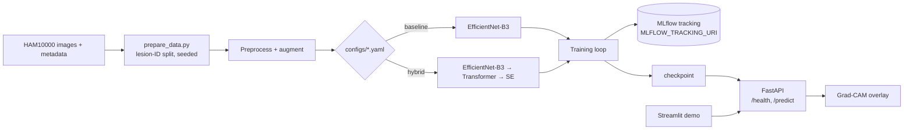

# Skin Lesion Classifier

A PyTorch classifier for the 7 diagnostic classes of [HAM10000](https://doi.org/10.7910/DVN/DBW86T), with MLflow experiment tracking, a FastAPI inference service with Grad-CAM explanations, and a small Streamlit demo.

> **Disclaimer: this is a research prototype, not a medical device.** It must not be used for diagnosis, screening, or any clinical decision. Predictions can be wrong, and the model has not been clinically validated.

## Architecture



## Quick start

Requires Python 3.10+. You must obtain HAM10000 yourself (Kaggle `kmader/skin-cancer-mnist-ham10000` or Harvard Dataverse) and place it under `data/HAM10000/` (`HAM10000_metadata.csv`, `HAM10000_images_part_1/`, `HAM10000_images_part_2/`).

```bash
python -m venv .venv && source .venv/bin/activate   # Windows: .venv\Scripts\activate
cp .env.example .env                                  # fill in values as needed
make install                                          # installs the package + api, ui, dev extras
python scripts/prepare_data.py                        # validate files, build lesion-ID split + data report
make train                                            # trains configs/baseline.yaml; CONFIG=configs/hybrid.yaml for the hybrid
make serve                                            # API on :8000 (needs checkpoints/best.pth)
streamlit run app/streamlit_app.py                    # demo UI, calls API_URL
make lint && make test                                # ruff + pytest (synthetic data, no dataset needed)
```

Smoke test: `python scripts/train.py --set data.subset=64 --set train.epochs=1`.

MLflow logs to a local SQLite file (`mlflow.db`) unless `MLFLOW_TRACKING_URI` is set (for example to an Azure ML workspace URI; see `docs/`).

**Logging to Azure ML: install with the `azure` extra.**

```bash
pip install -e ".[azure]"
```

The extra pins `mlflow==2.22.5` (and caps `sqlalchemy<2.1`, which MLflow 2.22.5's SQLite store needs). The reason: with MLflow 3.18 and azureml-mlflow 1.62.0.post6, artifact upload to Azure ML fails with a `TypeError`; with MLflow 2.22.5 it works. A plain `pip install -e .` installs MLflow 3.x, which is fine for local tracking only. Model logging in the code works on both MLflow 2.x and 3.x.

**Resuming training:** every epoch writes `train.checkpoint_dir/last.pth` (model, optimizer, epoch, best score and weights, saved config, MLflow run id). Set `train.resume=true` (e.g. `--set train.resume=true`) to continue from the next epoch in the same MLflow run. Resume refuses to start if the checkpoint's saved config differs from the current config (only `train.resume` may differ), and it never resumes a checkpoint from a completed run. If `AZURE_STORAGE_CONNECTION_STRING` is set, the checkpoint is uploaded to the Blob container `checkpoints` after every epoch, and downloaded from there on resume when no local file exists.

## Configuration

Everything tunable lives in `configs/`. `hybrid.yaml` inherits `baseline.yaml`. Any value can be overridden on the command line with `--set a.b=value`. Class-imbalance handling is switched independently with `imbalance.class_weighted_loss` and `imbalance.weighted_sampler`.

## Project structure

```
src/skin_lesion/
  data/        metadata, lesion-ID split, preprocessing, transforms, dataset
  models/      baseline (EfficientNet), hybrid (Transformer + SE), factory
  training/    loop, losses, metrics, MLflow tracking, trainer
  explain/     Grad-CAM
  api/         FastAPI app (/health, /predict)
configs/       baseline.yaml, hybrid.yaml
scripts/       train.py, evaluate.py, prepare_data.py
app/           Streamlit demo
tests/         pytest (tiny synthetic tensors)
```

## Results

TBD - experiments in progress.

## License and data

Code is for research and education. HAM10000 is distributed under CC BY-NC 4.0; check its terms before reuse.
